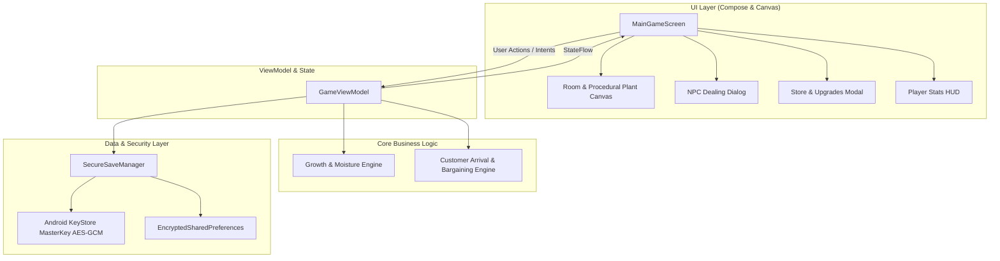

# Plant Tycoon Native (Android) Implementation Plan

> **For agentic workers:** REQUIRED SUB-SKILL: Use superpowers:subagent-driven-development to implement this plan task-by-task. Steps use checkbox (`- [ ]`) syntax for tracking.

**Goal:** Build a clean, modern, native Android plant/underground tycoon game in Kotlin with Jetpack Compose, featuring procedural Canvas rendering, offline delta growth calculation, NPC customer bargaining, and Android KeyStore secure persistence.

**Architecture:** MVVM architecture with Unidirectional Data Flow (UDF). `GameViewModel` acts as the single source of truth managing an immutable `StateFlow<GameState>`. Growth simulations use time-delta steps for battery efficiency, customer negotiations follow probabilistic curve models, and data persistence uses hardware-backed Android KeyStore AES-256-GCM.

**Architecture Diagram:**



**Tech Stack:** Kotlin 2.0+, Android SDK 35 (minSdk 26), Jetpack Compose (BOM 2024.09.00+), AndroidX Security Crypto 1.1.0-alpha06, Coroutines & StateFlow, JUnit 5.

**Spec:** `docs/superpowers/specs/2026-10-27-plant-tycoon-native-design.md`

## Global Constraints

* Language: Kotlin 2.0+
* Minimum Android SDK: 26 (Android 8.0)
* Target / Compile SDK: 35 (Android 15)
* Zero external game engine runtime dependencies (pure Android Jetpack)
* All game state must be immutable data classes (`copy()`)
* No hardware-locked `Settings.Secure.ANDROID_ID` in cryptographic operations
* `android:allowBackup="false"` in `AndroidManifest.xml`

---

## File Structure & Module Responsibilities

```
green-tycoon/
├── app/
│   ├── build.gradle.kts                      # Dependencies (Compose, Security, Coroutines, JUnit)
│   ├── src/
│   │   ├── main/
│   │   │   ├── AndroidManifest.xml           # Manifest (SDK 35, allowBackup=false, safe activities)
│   │   │   └── java/com/greentycoon/game/
│   │   │       ├── model/
│   │   │       │   ├── GameState.kt          # Complete immutable state hierarchy
│   │   │       │   ├── PlantModels.kt        # Strains, Pot types, Growth stages
│   │   │       │   └── NpcModels.kt          # Customers, negotiation curves, random events
│   │   │       ├── engine/
│   │   │       │   ├── GrowthEngine.kt       # Moisture depletion & offline delta growth math
│   │   │       │   └── DealingEngine.kt      # Customer generation, bargaining acceptance logic
│   │   │       ├── storage/
│   │   │       │   └── SecureSaveManager.kt  # MasterKey AES-256-GCM encrypted persistence
│   │   │       ├── ui/
│   │   │       │   ├── theme/
│   │   │       │   │   ├── Color.kt          # Retro neon & earthy game palette
│   │   │       │   │   └── Theme.kt          # Material 3 dark room theme
│   │   │       │   ├── canvas/
│   │   │       │   │   ├── RoomCanvas.kt     # Room background, lighting cones, pot stands
│   │   │       │   │   └── PlantCanvas.kt    # Procedural plant drawing (Seed, Sprout, Vegetative, Budding, Ready)
│   │   │       │   ├── components/
│   │   │       │   │   ├── TopHud.kt         # Cash, level, XP progress bar, stash weight
│   │   │       │   │   ├── PotActionRow.kt   # Water, fertilize, harvest, plant buttons
│   │   │       │   │   ├── DealingSheet.kt   # NPC dialog bottom sheet with price negotiation
│   │   │       │   │   └── ShopDialog.kt     # Seeds, pots, lights upgrade modal
│   │   │       │   ├── MainGameScreen.kt     # Master layout integrating HUD, Canvas, and Action rows
│   │   │       │   ├── GameViewModel.kt      # StateFlow holder, 1s tick loop, action dispatcher
│   │   │       │   └── MainActivity.kt       # Activity entry point with safe deep-link handling
│   │   └── test/java/com/greentycoon/game/
│   │       ├── GrowthEngineTest.kt           # Tests for growth speed, moisture decay, offline jump
│   │       ├── DealingEngineTest.kt          # Tests for customer arrival, pricing formula
│   │       └── SecureSaveManagerTest.kt      # Tests for serialization, decryption, tamper fallback
├── build.gradle.kts                          # Root project configuration
├── settings.gradle.kts                       # Root project settings
```

---

### Task 1: Project Scaffolding & Build Configuration

**Files:**
- Create: `build.gradle.kts`
- Create: `settings.gradle.kts`
- Create: `app/build.gradle.kts`
- Create: `app/src/main/AndroidManifest.xml`

**Interfaces:**
- Produces: Runnable Gradle project structure targeting SDK 35 with Jetpack Compose, Material 3, and AndroidX Security Crypto dependencies.

- [ ] **Step 1: Create `settings.gradle.kts`**
  Set root project name `green-tycoon` and include `:app` module with Google and Maven Central repositories.
- [ ] **Step 2: Create root `build.gradle.kts`**
  Configure Android Application Plugin (8.5+) and Kotlin Android Plugin (2.0+).
- [ ] **Step 3: Create `app/build.gradle.kts`**
  Configure `compileSdk = 35`, `minSdk = 26`, `targetSdk = 35`, Compose compiler, dependencies:
  - `androidx.core:core-ktx:1.13.1`
  - `androidx.lifecycle:lifecycle-viewmodel-compose:2.8.6`
  - `androidx.activity:activity-compose:1.9.2`
  - Compose BOM `2024.09.03` (UI, Material 3, Foundation)
  - `androidx.security:security-crypto:1.1.0-alpha06`
  - `org.jetbrains.kotlinx:kotlinx-coroutines-android:1.8.1`
  - Test dependencies: `junit:junit:4.13.2`, `org.jetbrains.kotlinx:kotlinx-coroutines-test:1.8.1`
- [ ] **Step 4: Create `app/src/main/AndroidManifest.xml`**
  Set `android:allowBackup="false"`, define `MainActivity` with `android:exported="true"`, orientation `portrait`, and safe custom URI scheme `<data android:scheme="greentycoon" android:host="game" />`.

---

### Task 2: Core Data Models & Enums

**Files:**
- Create: `app/src/main/java/com/greentycoon/game/model/PlantModels.kt`
- Create: `app/src/main/java/com/greentycoon/game/model/NpcModels.kt`
- Create: `app/src/main/java/com/greentycoon/game/model/GameState.kt`
- Test: `app/src/test/java/com/greentycoon/game/model/GameStateModelTest.kt`

**Interfaces:**
- Produces: Complete immutable domain models (`GameState`, `PlayerProfile`, `PotSlot`, `PotType`, `PlantStrain`, `PlantInstance`, `GrowthStage`, `StashInventory`, `RoomUpgrades`, `NpcCustomer`, `CustomerType`).

- [ ] **Step 1: Write unit test `GameStateModelTest.kt`**
  Verify default state instantiation, pot count, initial cash balance ($250.0), and copy immutability.
- [ ] **Step 2: Create `PlantModels.kt`**
  Implement `PotType`, `GrowthStage`, `PlantStrain`, and default strain catalog:
  - `SOUR_DIESEL`: fast growth (60s base), 25g yield, $10/g.
  - `OG_KUSH`: medium growth (120s base), 50g yield, $15/g.
  - `NORTHERN_LIGHTS`: slow growth (240s base), 100g yield, $25/g.
  - `PURPLE_HAZE`: master growth (360s base), 150g yield, $40/g.
- [ ] **Step 3: Create `NpcModels.kt`**
  Implement `CustomerType`, `NpcCustomer`, and `CustomerOfferResult`.
- [ ] **Step 4: Create `GameState.kt`**
  Implement `GameState`, `PlayerProfile`, `PotSlot`, `StashInventory`, `RoomUpgrades`, and `GameAction` sealed class.
- [ ] **Step 5: Run tests and verify**
  Run `GameStateModelTest` and ensure 100% pass.

---

### Task 3: Growth & Moisture Simulation Engine (with Offline Delta Calculation)

**Files:**
- Create: `app/src/main/java/com/greentycoon/game/engine/GrowthEngine.kt`
- Test: `app/src/test/java/com/greentycoon/game/engine/GrowthEngineTest.kt`

**Interfaces:**
- Consumes: `PlantInstance`, `PotType`, `RoomUpgrades`, `GrowthStage`.
- Produces: `GrowthEngine.tick(plant, potType, upgrades, deltaSeconds): PlantInstance` and `GrowthEngine.calculateOfflineGrowth(pots, upgrades, offlineSeconds): List<PotSlot>`.

- [ ] **Step 1: Write failing unit tests in `GrowthEngineTest.kt`**
  - Test 1: Moisture decays properly over 10 seconds.
  - Test 2: Growth advances when moisture > 0%.
  - Test 3: Growth freezes when moisture == 0%.
  - Test 4: Offline jump: 120 seconds of offline time produces exact same progress as 120 individual 1-second ticks.
  - Test 5: Fertilizer accelerates growth speed by 1.5x.
- [ ] **Step 2: Run test to confirm failure**
- [ ] **Step 3: Implement `GrowthEngine.kt`**
  Implement mathematical formulas for moisture decay, light speed multipliers, stage transitions (`SEED` -> `SPROUT` -> `VEGETATIVE` -> `BUDDING` -> `READY`), and deterministic offline progression.
- [ ] **Step 4: Run test to confirm all tests pass**

---

### Task 4: NPC Dealing Engine & Bargaining Logic

**Files:**
- Create: `app/src/main/java/com/greentycoon/game/engine/DealingEngine.kt`
- Test: `app/src/test/java/com/greentycoon/game/engine/DealingEngineTest.kt`

**Interfaces:**
- Consumes: `PlayerProfile`, `StashInventory`, `RoomUpgrades`.
- Produces: `DealingEngine.generateVisitor(gameState, random): NpcCustomer?`, `DealingEngine.evaluateBargain(customer, requestedPrice, playerRespect, random): DealOutcome`.

- [ ] **Step 1: Write failing unit tests in `DealingEngineTest.kt`**
  - Test 1: No customer generated if player stash has 0 grams of all strains.
  - Test 2: Bargaining at base price has >90% acceptance.
  - Test 3: Bargaining at +100% over base price has near 0% acceptance.
  - Test 4: Higher respect score increases bargain acceptance probability.
  - Test 5: Cop event triggered probabilistically; bribe cost scales with player cash.
- [ ] **Step 2: Run test to confirm failure**
- [ ] **Step 3: Implement `DealingEngine.kt`**
  Implement probability generators, customer dialogue selection, and the negotiation curve algorithm.
- [ ] **Step 4: Run test to confirm all tests pass**

---

### Task 5: Secure Persistence Layer (Android KeyStore & Non-Device-Locked Encryption)

**Files:**
- Create: `app/src/main/java/com/greentycoon/game/storage/SecureSaveManager.kt`
- Test: `app/src/test/java/com/greentycoon/game/storage/SecureSaveManagerTest.kt`

**Interfaces:**
- Consumes: `GameState`.
- Produces: `saveGame(state: GameState)`, `loadGame(): GameState?`, `resetSave()`.

- [ ] **Step 1: Write failing unit tests in `SecureSaveManagerTest.kt`**
  - Test 1: Serialize `GameState` to JSON and back, ensuring exact field equality.
  - Test 2: Corrupted or tampered JSON string safely catches parse error and returns default initial `GameState`.
  - Test 3: Tampered HMAC signature flags save corruption.
- [ ] **Step 2: Run test to confirm failure**
- [ ] **Step 3: Implement `SecureSaveManager.kt`**
  Implement JSON serializer with HMAC-SHA256 signature and `EncryptedSharedPreferences` / `MasterKey` storage.
- [ ] **Step 4: Run test to confirm all tests pass**

---

### Task 6: Procedural Plant & Room Canvas Rendering (Jetpack Compose Canvas)

**Files:**
- Create: `app/src/main/java/com/greentycoon/game/ui/theme/Color.kt`
- Create: `app/src/main/java/com/greentycoon/game/ui/theme/Theme.kt`
- Create: `app/src/main/java/com/greentycoon/game/ui/canvas/RoomCanvas.kt`
- Create: `app/src/main/java/com/greentycoon/game/ui/canvas/PlantCanvas.kt`

**Interfaces:**
- Consumes: `PotSlot`, `PlantInstance`, `GrowthStage`, `RoomUpgrades`.
- Produces: `@Composable RoomCanvas(pots: List<PotSlot>, upgrades: RoomUpgrades, onPotClicked: (Int) -> Unit)`.

- [ ] **Step 1: Create `Color.kt` and `Theme.kt`**
  Define neon green (`#00E676`), dark room background (`#121212`), soil brown (`#4A3525`), water blue (`#29B6F6`), and gold ready glow (`#FFD700`).
- [ ] **Step 2: Create `PlantCanvas.kt`**
  Implement procedural Canvas drawing routines:
  - `drawSeed()`: Small seed dot with soil particle texture.
  - `drawSprout()`: Dual-leaf green sprout.
  - `drawVegetative()`: Multi-tiered stem with 5-lobed serrated leaves animated with harmonic wind sway (`sin(time)`).
  - `drawBudding()`: Clustered flower buds with glistening resin glands.
  - `drawReady()`: Full mature plant with pulsating golden glow halo.
- [ ] **Step 3: Create `RoomCanvas.kt`**
  Render wall gradients, floor wood plank lines, hanging grow light lamp with light cone brush, pot rims, and moisture level indicators.

---

### Task 7: UI Components & Game Screens

**Files:**
- Create: `app/src/main/java/com/greentycoon/game/ui/components/TopHud.kt`
- Create: `app/src/main/java/com/greentycoon/game/ui/components/PotActionRow.kt`
- Create: `app/src/main/java/com/greentycoon/game/ui/components/DealingSheet.kt`
- Create: `app/src/main/java/com/greentycoon/game/ui/components/ShopDialog.kt`
- Create: `app/src/main/java/com/greentycoon/game/ui/MainGameScreen.kt`

**Interfaces:**
- Consumes: `GameState`, `GameViewModel`.
- Produces: Complete interactive game interface.

- [ ] **Step 1: Create `TopHud.kt`**
  Display Cash with animated counter, Level badge, XP progress bar, and total stash inventory weight.
- [ ] **Step 2: Create `PotActionRow.kt`**
  Display buttons: `[💧 Water All]`, `[🧪 Fertilize]`, `[✂️ Harvest]`, `[🛒 Shop]`, `[🎒 Stash]`.
- [ ] **Step 3: Create `DealingSheet.kt`**
  Modal bottom sheet showing customer avatar, dialogue bubble, price slider, "Accept", "Refuse", and "Bribe" buttons.
- [ ] **Step 4: Create `ShopDialog.kt`**
  Store modal with tabs: *Seeds* (purchase strain seeds), *Pots* (upgrade to ceramic/hydro), *Lights* (upgrade grow lamps).
- [ ] **Step 5: Create `MainGameScreen.kt`**
  Integrate `TopHud`, `RoomCanvas`, action controls, and dialog overlays.

---

### Task 8: ViewModel, 1-Second Game Loop & Activity Integration

**Files:**
- Create: `app/src/main/java/com/greentycoon/game/ui/GameViewModel.kt`
- Create: `app/src/main/java/com/greentycoon/game/MainActivity.kt`
- Test: `app/src/test/java/com/greentycoon/game/ui/GameViewModelTest.kt`

**Interfaces:**
- Consumes: All engines and storage layers.
- Produces: Complete runnable Android application.

- [ ] **Step 1: Write unit tests in `GameViewModelTest.kt`**
  Test action dispatching: `WaterPot`, `PlantSeed`, `HarvestPot`, `AcceptDeal`, `BuySeeds`.
- [ ] **Step 2: Implement `GameViewModel.kt`**
  - Launch coroutine ticking loop (1 tick per second).
  - Calculate offline delta on initialization.
  - Implement action handlers for planting, watering, harvesting, and dealing.
  - Auto-save state every 10 seconds and on critical actions.
- [ ] **Step 3: Implement `MainActivity.kt`**
  Set Compose content to `MainGameScreen`, handle lifecycle pause/resume, and safely validate any incoming deep links.
- [ ] **Step 4: Run full test suite and verify end-to-end functionality**

---

## Plan Verification Checkpoints

1. **Deterministic Test Execution:** Run `./gradlew test` to verify all domain, engine, and persistence tests pass.
2. **Android Lint & Security Check:** Verify `allowBackup="false"`, no hardcoded `ANDROID_ID`, target SDK 35.
3. **Save Game Crash Resistance:** Simulate app process kill and device timestamp jump; confirm plants grow accurately and save loads without crash.
