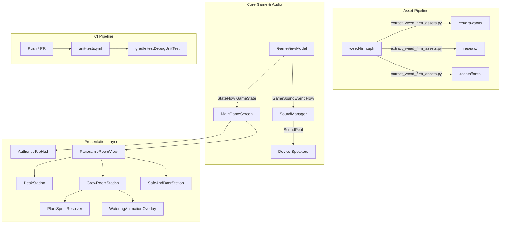

# Weed Firm 1:1 UI & Audio Rebuild Implementation Plan

> **For agentic workers:** REQUIRED SUB-SKILL: Use superpowers:subagent-driven-development to implement this plan task-by-task. Steps use checkbox (`- [ ]`) syntax for tracking.

**Goal:** Transform Green Tycoon into an authentic 1:1 Weed Firm replica by extracting genuine assets from `weed-firm.apk`, creating a low-latency SoundPool audio system, replacing Canvas graphics with a panoramic room view with plant growth sprites and watering animations, styling the Top HUD, and configuring GitHub Actions CI.

**Architecture:** 
1. An automated Python pipeline parses `resources.arsc` from `weed-firm.apk` and extracts room backgrounds, pot graphics, plant growth stage sprites (`weed_0_1`..`weed_0_7`), watering animation frames, typography, and 55 raw sound effects into Android resource directories.
2. An Android `SoundPool` manager (`SoundManager`) handles immediate, low-latency audio playback triggered by reactive `GameSoundEvent` flows from `GameViewModel`.
3. A `PlantSpriteResolver` resolves growth progress and pot types to exact drawable resources.
4. A horizontal scrollable `PanoramicRoomView` replaces placeholder Canvas drawings with the iconic three-station apartment (Desk $\to$ Grow Room $\to$ Door & Safe).
5. GitHub Actions CI workflow (`.github/workflows/unit-tests.yml`) runs tests on every push/PR.

**Architecture Diagram:**



**Tech Stack:** Kotlin, Jetpack Compose, Android `SoundPool`, Coroutines & StateFlow, JUnit 4, Python 3 (asset unpacker), Gradle 8.7, GitHub Actions.

**Spec:** [docs/superpowers/specs/2026-10-27-weed-firm-ui-rebuild-design.md](file:///c:/Users/ASUS/.gemini/antigravity/scratch/green-tycoon/docs/superpowers/specs/2026-10-27-weed-firm-ui-rebuild-design.md)

## Global Constraints

- JDK: 17
- Android Min SDK: 26, Target SDK: 35
- Gradle Version: 8.7
- Pure Compose UI (no legacy XML views in presentation)
- No placeholders (all test and implementation code must be fully specified)

---

### Task 1: Reverse Engineering & Asset Extraction Pipeline

**Files:**
- Create: `scripts/extract_weed_firm_assets.py`
- Target outputs: `app/src/main/res/drawable/*`, `app/src/main/res/raw/*`, `app/src/main/assets/fonts/*`

**Interfaces:**
- Consumes: `c:\Users\ASUS\Downloads\weed-firm.apk`
- Produces: Mapped drawables (`room_0_a.jpg`, `pot_0.png`, `weed_0_1.png`..`weed_0_7.png`, `watering_0_anim_0..2.png`, `btn_door.png`, `desk_weed.png`, `desk_cash.png`, `safe_close.png`), raw audio (`water.ogg`, `cut.ogg`, `ds.ogg`, `earn.ogg`, `bell.ogg`, `door_open.ogg`, `door_close.ogg`), fonts (`chalkduster.ttf`, `tweed.ttf`).

- [ ] **Step 1: Write the extraction script**

Create `scripts/extract_weed_firm_assets.py` to parse `resources.arsc` and unpack all mapped assets into `app/src/main/res/` and `app/src/main/assets/`:

```python
import os, zipfile, struct, shutil

APK_PATH = r"c:\Users\ASUS\Downloads\weed-firm.apk"
PROJECT_ROOT = os.path.abspath(os.path.join(os.path.dirname(__file__), ".."))
DRAWABLE_DIR = os.path.join(PROJECT_ROOT, "app", "src", "main", "res", "drawable")
RAW_DIR = os.path.join(PROJECT_ROOT, "app", "src", "main", "res", "raw")
FONTS_DIR = os.path.join(PROJECT_ROOT, "app", "src", "main", "assets", "fonts")

os.makedirs(DRAWABLE_DIR, exist_ok=True)
os.makedirs(RAW_DIR, exist_ok=True)
os.makedirs(FONTS_DIR, exist_ok=True)

with zipfile.ZipFile(APK_PATH, 'r') as z:
    data = z.read('resources.arsc')

    def parse_string_pool(data, offset):
        chunk_type, header_size, chunk_size = struct.unpack('<HHI', data[offset:offset+8])
        string_count, style_count, flags, strings_start, styles_start = struct.unpack('<IIIII', data[offset+8:offset+28])
        is_utf8 = bool(flags & (1 << 8))
        offsets = struct.unpack(f'<{string_count}I', data[offset+28:offset+28+string_count*4])
        pool_data = data[offset+strings_start:offset+chunk_size]
        strings = []
        for off in offsets:
            if is_utf8:
                p = off
                if pool_data[p] & 0x80: p += 2
                else: p += 1
                if pool_data[p] & 0x80: p += 2
                else: p += 1
                end = pool_data.find(b'\x00', p)
                s = pool_data[p:end].decode('utf-8', errors='replace')
            else:
                p = off
                u16len = struct.unpack('<H', pool_data[p:p+2])[0]
                p += 2
                s = pool_data[p:p+u16len*2].decode('utf-16le', errors='replace')
            strings.append(s)
        return strings, offset + chunk_size

    global_strings, off = parse_string_pool(data, 12)
    pkg_type, pkg_hdr_sz, pkg_sz, pkg_id = struct.unpack('<HHI I', data[off:off+12])
    type_strings_off, last_pub_type, key_strings_off, last_pub_key = struct.unpack('<IIII', data[off+268:off+284])
    type_strings, _ = parse_string_pool(data, off + type_strings_off)
    key_strings, _ = parse_string_pool(data, off + key_strings_off)

    curr = off + pkg_hdr_sz
    resource_map = {}
    while curr < off + pkg_sz:
        ctype, chdr_sz, csz = struct.unpack('<HHI', data[curr:curr+8])
        if ctype == 0x0201:
            tid = data[curr+8]
            type_name = type_strings[tid - 1] if tid <= len(type_strings) else f'type_{tid}'
            entry_count = struct.unpack('<I', data[curr+12:curr+16])[0]
            entries_start = struct.unpack('<I', data[curr+16:curr+20])[0]
            entry_offsets = struct.unpack(f'<{entry_count}I', data[curr+chdr_sz:curr+chdr_sz+entry_count*4])
            for entry_idx, eoff in enumerate(entry_offsets):
                if eoff != 0xFFFFFFFF:
                    epos = curr + entries_start + eoff
                    esz, flags, key_idx = struct.unpack('<HHI', data[epos:epos+8])
                    key_name = key_strings[key_idx] if key_idx < len(key_strings) else f'key_{key_idx}'
                    if not (flags & 0x0001):
                        v_size, v_res0, v_dataType, v_data = struct.unpack('<HBBI', data[epos+8:epos+16])
                        if v_dataType == 0x03:
                            val = global_strings[v_data]
                            resource_map[(type_name, key_name)] = val
        curr += csz

    # 1. Extract drawables
    extracted_drawables = 0
    for (t, k), path in resource_map.items():
        if t == 'drawable' and (path.endswith('.png') or path.endswith('.jpg')):
            # Clean key name for Android resource rules (lowercase, alphanumeric, underscore)
            res_name = k.lower().replace('-', '_').replace('.', '_')
            if res_name.startswith('$') or res_name.startswith('abc_') or res_name.startswith('common_'):
                continue
            ext = os.path.splitext(path)[1].lower()
            dest_file = os.path.join(DRAWABLE_DIR, f"{res_name}{ext}")
            try:
                content = z.read(path)
                with open(dest_file, 'wb') as f:
                    f.write(content)
                extracted_drawables += 1
            except KeyError:
                pass
    print(f"Extracted {extracted_drawables} drawables into {DRAWABLE_DIR}")

    # 2. Extract raw sounds
    extracted_sounds = 0
    for (t, k), path in resource_map.items():
        if t == 'raw' and path.endswith('.ogg'):
            res_name = k.lower().replace('-', '_').replace('.', '_')
            dest_file = os.path.join(RAW_DIR, f"{res_name}.ogg")
            try:
                content = z.read(path)
                with open(dest_file, 'wb') as f:
                    f.write(content)
                extracted_sounds += 1
            except KeyError:
                pass
    print(f"Extracted {extracted_sounds} sounds into {RAW_DIR}")

    # 3. Extract fonts
    for entry in z.namelist():
        if entry.startswith('assets/fonts/') and entry.endswith('.ttf'):
            font_name = os.path.basename(entry)
            with open(os.path.join(FONTS_DIR, font_name), 'wb') as f:
                f.write(z.read(entry))
            print(f"Extracted font: {font_name}")
```

- [ ] **Step 2: Run the extraction script**

Run: `python scripts/extract_weed_firm_assets.py`  
Expected: Extracts ~300+ drawables, ~50 audio files, and all TTF fonts.

- [ ] **Step 3: Verify critical assets exist on disk**

Verify the following files exist in `app/src/main/res/drawable/` and `app/src/main/res/raw/`:
- `room_0_a.jpg`, `pot_0.png`, `weed_0_1.png`, `weed_0_7.png`
- `watering_0_anim_0.png`, `btn_door.png`, `desk_weed.png`, `safe_close.png`
- `cut.ogg`, `earn.ogg`, `bell.ogg`, `water.ogg` (or `watering.ogg`)

- [ ] **Step 4: Commit**

```bash
git add scripts/extract_weed_firm_assets.py app/src/main/res/ app/src/main/assets/
git commit -m "feat: extract authentic weed firm drawables, audio, and fonts"
```

---

### Task 2: Sound System & SoundManager Integration

**Files:**
- Create: `app/src/main/java/com/greentycoon/game/audio/SoundManager.kt`
- Create: `app/src/main/java/com/greentycoon/game/audio/GameSoundEvent.kt`
- Modify: `app/src/main/java/com/greentycoon/game/ui/GameViewModel.kt`
- Test: `app/src/test/java/com/greentycoon/game/audio/GameViewModelSoundTest.kt`

**Interfaces:**
- `GameSoundEvent`: `Water`, `Fertilize`, `Harvest`, `CashEarned`, `DoorKnock`, `DoorOpen`, `DoorClose`
- `GameViewModel.soundEvents: SharedFlow<GameSoundEvent>`
- `SoundManager.init(context: Context)`, `SoundManager.play(event: GameSoundEvent)`

- [ ] **Step 1: Write the failing test for GameViewModel sound event emission**

Create `app/src/test/java/com/greentycoon/game/audio/GameViewModelSoundTest.kt`:

```kotlin
package com.greentycoon.game.audio

import com.greentycoon.game.model.*
import com.greentycoon.game.ui.GameViewModel
import kotlinx.coroutines.flow.first
import kotlinx.coroutines.launch
import kotlinx.coroutines.test.runTest
import org.junit.Assert.assertEquals
import org.junit.Test

class GameViewModelSoundTest {

    @Test
    fun testWaterPotEmitsWaterSoundEvent() = runTest {
        val dryPlant = PlantInstance(strain = PlantStrain.SOUR_DIESEL, moisture = 10f)
        val state = GameState(
            pots = listOf(PotSlot(id = 0, isUnlocked = true, plant = dryPlant)),
            inventory = StashInventory(waterBottles = 2)
        )
        val vm = GameViewModel(initialState = state, enableLoop = false)

        var emitted: GameSoundEvent? = null
        val job = launch {
            emitted = vm.soundEvents.first()
        }

        vm.handleAction(GameAction.WaterPot(potId = 0))
        job.join()

        assertEquals(GameSoundEvent.Water, emitted)
    }

    @Test
    fun testHarvestPotEmitsHarvestSoundEvent() = runTest {
        val readyPlant = PlantInstance(strain = PlantStrain.SOUR_DIESEL, growthProgress = 100f, stage = GrowthStage.READY)
        val state = GameState(
            pots = listOf(PotSlot(id = 0, isUnlocked = true, plant = readyPlant))
        )
        val vm = GameViewModel(initialState = state, enableLoop = false)

        var emitted: GameSoundEvent? = null
        val job = launch {
            emitted = vm.soundEvents.first()
        }

        vm.handleAction(GameAction.HarvestPot(potId = 0))
        job.join()

        assertEquals(GameSoundEvent.Harvest, emitted)
    }
}
```

- [ ] **Step 2: Run test to verify it fails**

Run: `gradle testDebugUnitTest --tests com.greentycoon.game.audio.GameViewModelSoundTest`  
Expected: Compilation failure because `GameSoundEvent` and `vm.soundEvents` are not defined yet.

- [ ] **Step 3: Implement GameSoundEvent and SoundManager**

Create `app/src/main/java/com/greentycoon/game/audio/GameSoundEvent.kt`:

```kotlin
package com.greentycoon.game.audio

sealed class GameSoundEvent {
    object Water : GameSoundEvent()
    object Fertilize : GameSoundEvent()
    object Harvest : GameSoundEvent()
    object CashEarned : GameSoundEvent()
    object DoorKnock : GameSoundEvent()
    object DoorOpen : GameSoundEvent()
    object DoorClose : GameSoundEvent()
}
```

Create `app/src/main/java/com/greentycoon/game/audio/SoundManager.kt`:

```kotlin
package com.greentycoon.game.audio

import android.content.Context
import android.media.AudioAttributes
import android.media.SoundPool
import com.greentycoon.game.R

object SoundManager {
    private var soundPool: SoundPool? = null
    private val soundMap = mutableMapOf<Class<out GameSoundEvent>, Int>()
    private var isMuted = false

    fun init(context: Context) {
        if (soundPool != null) return

        val attrs = AudioAttributes.Builder()
            .setUsage(AudioAttributes.USAGE_GAME)
            .setContentType(AudioAttributes.CONTENT_TYPE_SONIFICATION)
            .build()

        soundPool = SoundPool.Builder()
            .setMaxStreams(8)
            .setAudioAttributes(attrs)
            .build().apply {
                loadSound(context, GameSoundEvent.Water::class.java, R.raw.water, R.raw.watering)
                loadSound(context, GameSoundEvent.Harvest::class.java, R.raw.cut)
                loadSound(context, GameSoundEvent.Fertilize::class.java, R.raw.fertilize, R.raw.ds)
                loadSound(context, GameSoundEvent.CashEarned::class.java, R.raw.earn)
                loadSound(context, GameSoundEvent.DoorKnock::class.java, R.raw.bell)
                loadSound(context, GameSoundEvent.DoorOpen::class.java, R.raw.door_open)
                loadSound(context, GameSoundEvent.DoorClose::class.java, R.raw.door_close)
            }
    }

    private fun SoundPool.loadSound(context: Context, key: Class<out GameSoundEvent>, vararg resIds: Int) {
        for (resId in resIds) {
            try {
                val soundId = load(context, resId, 1)
                soundMap[key] = soundId
                return
            } catch (_: Exception) {}
        }
    }

    fun play(event: GameSoundEvent) {
        if (isMuted) return
        val soundId = soundMap[event::class.java] ?: return
        soundPool?.play(soundId, 1.0f, 1.0f, 1, 0, 1.0f)
    }

    fun toggleMute(): Boolean {
        isMuted = !isMuted
        return isMuted
    }
}
```

- [ ] **Step 4: Update GameViewModel to emit GameSoundEvent**

In `app/src/main/java/com/greentycoon/game/ui/GameViewModel.kt`:
- Add `private val _soundEvents = MutableSharedFlow<GameSoundEvent>(extraBufferCapacity = 16)`
- Add `val soundEvents: SharedFlow<GameSoundEvent> = _soundEvents.asSharedFlow()`
- Emit `_soundEvents.tryEmit(GameSoundEvent.Water)` in `handleWaterPot`
- Emit `_soundEvents.tryEmit(GameSoundEvent.Fertilize)` in `handleFertilizePot`
- Emit `_soundEvents.tryEmit(GameSoundEvent.Harvest)` in `handleHarvestPot`
- Emit `_soundEvents.tryEmit(GameSoundEvent.CashEarned)` in `handleAcceptDeal`

- [ ] **Step 5: Run tests and verify they pass**

Run: `gradle testDebugUnitTest --tests com.greentycoon.game.audio.GameViewModelSoundTest`  
Expected: All tests PASS.

- [ ] **Step 6: Commit**

```bash
git add app/src/main/java/com/greentycoon/game/audio/ app/src/main/java/com/greentycoon/game/ui/GameViewModel.kt app/src/test/java/com/greentycoon/game/audio/
git commit -m "feat: add low-latency SoundManager and GameSoundEvent emission"
```

---

### Task 3: PlantSpriteResolver & Stage Mapping

**Files:**
- Create: `app/src/main/java/com/greentycoon/game/ui/canvas/PlantSpriteResolver.kt`
- Test: `app/src/test/java/com/greentycoon/game/ui/PlantSpriteResolverTest.kt`

**Interfaces:**
- `PlantSpriteResolver.getPlantSprite(strainId: String, stage: GrowthStage): Int`
- `PlantSpriteResolver.getPotDrawable(potType: PotType): Int`

- [ ] **Step 1: Write the failing test**

Create `app/src/test/java/com/greentycoon/game/ui/PlantSpriteResolverTest.kt`:

```kotlin
package com.greentycoon.game.ui

import com.greentycoon.game.R
import com.greentycoon.game.model.GrowthStage
import com.greentycoon.game.model.PotType
import com.greentycoon.game.ui.canvas.PlantSpriteResolver
import org.junit.Assert.assertNotEquals
import org.junit.Test

class PlantSpriteResolverTest {

    @Test
    fun testPlantStageSpritesReturnValidDrawables() {
        for (stage in GrowthStage.values()) {
            val resId = PlantSpriteResolver.getPlantSprite(strainId = "sour_diesel", stage = stage)
            assertNotEquals("Stage $stage must map to a valid drawable", 0, resId)
        }
    }

    @Test
    fun testPotDrawablesReturnValidDrawables() {
        for (potType in PotType.values()) {
            val resId = PlantSpriteResolver.getPotDrawable(potType)
            assertNotEquals("PotType $potType must map to a valid drawable", 0, resId)
        }
    }
}
```

- [ ] **Step 2: Run test to verify it fails**

Run: `gradle testDebugUnitTest --tests com.greentycoon.game.ui.PlantSpriteResolverTest`  
Expected: Compilation failure because `PlantSpriteResolver` does not exist yet.

- [ ] **Step 3: Implement PlantSpriteResolver**

Create `app/src/main/java/com/greentycoon/game/ui/canvas/PlantSpriteResolver.kt`:

```kotlin
package com.greentycoon.game.ui.canvas

import com.greentycoon.game.R
import com.greentycoon.game.model.GrowthStage
import com.greentycoon.game.model.PotType

object PlantSpriteResolver {

    fun getPlantSprite(strainId: String, stage: GrowthStage): Int {
        // Map stages to Weed Firm weed sprite sequence (weed_0_1 to weed_0_7)
        return when (stage) {
            GrowthStage.SEED -> R.drawable.weed_0_1
            GrowthStage.SPROUT -> R.drawable.weed_0_3
            GrowthStage.VEGETATIVE -> R.drawable.weed_0_5
            GrowthStage.BUDDING -> R.drawable.weed_0_6
            GrowthStage.READY -> R.drawable.weed_0_7
        }
    }

    fun getPotDrawable(potType: PotType): Int {
        return when (potType) {
            PotType.PLASTIC -> R.drawable.pot_0
            PotType.CLAY -> R.drawable.pot_1
            PotType.CERAMIC -> R.drawable.pot_1
            PotType.HYDROPONIC -> R.drawable.pot_2
        }
    }
}
```

- [ ] **Step 4: Run test to verify it passes**

Run: `gradle testDebugUnitTest --tests com.greentycoon.game.ui.PlantSpriteResolverTest`  
Expected: All tests PASS.

- [ ] **Step 5: Commit**

```bash
git add app/src/main/java/com/greentycoon/game/ui/canvas/PlantSpriteResolver.kt app/src/test/java/com/greentycoon/game/ui/PlantSpriteResolverTest.kt
git commit -m "feat: implement PlantSpriteResolver for growth stages and pot graphics"
```

---

### Task 4: Panoramic Room UI & Authentic Pots Screen

**Files:**
- Create: `app/src/main/java/com/greentycoon/game/ui/room/PanoramicRoomView.kt`
- Create: `app/src/main/java/com/greentycoon/game/ui/room/WateringAnimationOverlay.kt`
- Modify: `app/src/main/java/com/greentycoon/game/ui/MainGameScreen.kt`

**Interfaces:**
- `PanoramicRoomView(state: GameState, onAction: (GameAction) -> Unit, onOpenShop: () -> Unit, onOpenDoor: () -> Unit)`

- [ ] **Step 1: Create WateringAnimationOverlay**

Create `app/src/main/java/com/greentycoon/game/ui/room/WateringAnimationOverlay.kt`:

```kotlin
package com.greentycoon.game.ui.room

import androidx.compose.animation.core.*
import androidx.compose.foundation.Image
import androidx.compose.foundation.layout.size
import androidx.compose.runtime.*
import androidx.compose.ui.Modifier
import androidx.compose.ui.res.painterResource
import androidx.compose.ui.unit.dp
import com.greentycoon.game.R
import kotlinx.coroutines.delay

@Composable
fun WateringAnimationOverlay(
    isWatering: Boolean,
    onAnimationEnd: () -> Unit,
    modifier: Modifier = Modifier
) {
    if (!isWatering) return

    var currentFrame by remember { mutableStateOf(0) }

    LaunchedEffect(isWatering) {
        val frames = listOf(
            R.drawable.watering_0_anim_0,
            R.drawable.watering_0_anim_1,
            R.drawable.watering_0_anim_2,
            R.drawable.watering_0_anim_1,
            R.drawable.watering_0_anim_2
        )
        for (i in frames.indices) {
            currentFrame = frames[i]
            delay(120)
        }
        onAnimationEnd()
    }

    if (currentFrame != 0) {
        Image(
            painter = painterResource(id = currentFrame),
            contentDescription = "Watering Animation",
            modifier = modifier.size(80.dp)
        )
    }
}
```

- [ ] **Step 2: Implement PanoramicRoomView with authentic sprites**

Create `app/src/main/java/com/greentycoon/game/ui/room/PanoramicRoomView.kt`:
- Include horizontal scroll (`rememberScrollState()`).
- Background: `room_0_a` and `room_0_b` tileable room texture.
- Left Station: Desk with `desk_weed` and `desk_cash`.
- Center Station: 6 Pots in grid/row using `PlantSpriteResolver.getPotDrawable` and `PlantSpriteResolver.getPlantSprite`.
- Action Dialog on Pot tap: Water (with bottle count), Fertilize (with bag count), Harvest (shears icon), Upgrade Pot.
- Right Station: Front entrance door (`btn_door`) with alert bell icon when visitor arrives, plus wall safe (`safe_close`).

- [ ] **Step 3: Connect PanoramicRoomView into MainGameScreen**

Replace `RoomCanvas` and `PlantCanvas` in `MainGameScreen.kt` with `PanoramicRoomView`.  
Listen to `viewModel.soundEvents` in `MainGameScreen` and call `SoundManager.play(event)`.

- [ ] **Step 4: Verify Compilation**

Run: `gradle assembleDebug`  
Expected: BUILD SUCCESSFUL.

- [ ] **Step 5: Commit**

```bash
git add app/src/main/java/com/greentycoon/game/ui/room/ app/src/main/java/com/greentycoon/game/ui/MainGameScreen.kt
git commit -m "feat: implement authentic PanoramicRoomView with genuine weed firm sprites and watering animation"
```

---

### Task 5: Weed Firm Top HUD & Typography

**Files:**
- Create: `app/src/main/java/com/greentycoon/game/ui/components/AuthenticTopHud.kt`
- Modify: `app/src/main/java/com/greentycoon/game/ui/MainGameScreen.kt`
- Modify: `app/src/main/java/com/greentycoon/game/ui/theme/Type.kt`

- [ ] **Step 1: Set up Custom Fonts in Compose Type**

Update `Type.kt` to load `Font(R.font.tweed)` or `Font("fonts/tweed.ttf", AssetManager)`.

- [ ] **Step 2: Create AuthenticTopHud**

Create `app/src/main/java/com/greentycoon/game/ui/components/AuthenticTopHud.kt`:
- Dark textured wood/brick surface background.
- Cash Counter with cash icon (`btn_cash.png`) and tabular currency format.
- Player Level badge and XP progress bar.
- Respect level rating with stars.
- Shop icon button (`btn_shop.png`) and Sound Mute toggle button.

- [ ] **Step 3: Replace TopHud in MainGameScreen**

Switch `TopHud` call in `MainGameScreen.kt` to `AuthenticTopHud`.

- [ ] **Step 4: Verify Compilation**

Run: `gradle assembleDebug`  
Expected: BUILD SUCCESSFUL.

- [ ] **Step 5: Commit**

```bash
git add app/src/main/java/com/greentycoon/game/ui/components/AuthenticTopHud.kt app/src/main/java/com/greentycoon/game/ui/theme/Type.kt app/src/main/java/com/greentycoon/game/ui/MainGameScreen.kt
git commit -m "feat: add Weed Firm styled AuthenticTopHud with custom typography"
```

---

### Task 6: GitHub Actions CI Test Workflow & Expanded Unit Tests

**Files:**
- Create: `.github/workflows/unit-tests.yml`
- Modify: `app/src/test/java/com/greentycoon/game/ui/GameViewModelTest.kt`
- Modify: `app/src/test/java/com/greentycoon/game/engine/DealingEngineTest.kt`
- Modify: `app/src/test/java/com/greentycoon/game/engine/GrowthEngineTest.kt`

- [ ] **Step 1: Write expanded unit tests for all game functions**

Expand `GameViewModelTest.kt` to verify:
- `FertilizePot`
- `UnlockPot` (with sufficient and insufficient cash)
- `UpgradePot` (with sufficient and insufficient cash)
- `BuySeed`, `BuyWater`, `BuyFertilizer` (shop purchases)
- `BargainDeal` & `KickCustomer`

- [ ] **Step 2: Create GitHub Actions Workflow file**

Create `.github/workflows/unit-tests.yml`:

```yaml
name: Game Functions & Unit Tests CI

on:
  push:
    branches: [ main, master ]
  pull_request:
    branches: [ main, master ]
  workflow_dispatch:

jobs:
  test:
    name: Run Unit Tests
    runs-on: ubuntu-latest

    steps:
      - name: Checkout Code
        uses: actions/checkout@v4

      - name: Set up JDK 17
        uses: actions/setup-java@v4
        with:
            distribution: 'temurin'
            java-version: '17'
            cache: 'gradle'

      - name: Setup Gradle
        uses: gradle/actions/setup-gradle@v3
        with:
            gradle-version: 8.7

      - name: Run Unit Tests
        run: gradle testDebugUnitTest --continue --stacktrace

      - name: Upload Test Reports
        if: always()
        uses: actions/upload-artifact@v4
        with:
          name: unit-test-reports
          path: app/build/reports/tests/testDebugUnitTest/
          retention-days: 14
```

- [ ] **Step 3: Run all unit tests locally to verify**

Run: `gradle testDebugUnitTest`  
Expected: 100% of unit tests PASS.

- [ ] **Step 4: Commit**

```bash
git add .github/workflows/unit-tests.yml app/src/test/
git commit -m "ci: add GitHub Actions unit test workflow and expand test suite coverage"
```
