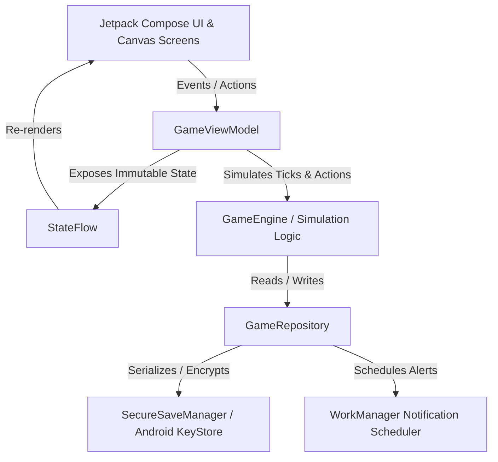

# Plant Tycoon Native (Android) - Game Design Specification

**Document Version:** 1.0.0  
**Date:** 2026-10-27  
**Author:** Antigravity Engineering  
**Status:** In Review  
**Target Platform:** Android (minSdkVersion: 26, targetSdkVersion: 35)

---

## 1. Executive Summary & Goals

This specification defines a clean-room, modern Android recreation of the classic plant/underground simulation tycoon mechanics (inspired by the core game loops of *Weed Firm*). 

The primary objective is to replace the obsolete, insecure, and buggy architecture found in legacy versions (such as deprecated Billing v4, device-bound `ANDROID_ID` encryption failures, dynamic DEX loading risks, and unvalidated deep-links) with a high-performance, robust, modern native Android application built using **Kotlin**, **Jetpack Compose**, **Procedural Canvas Rendering**, and **Android KeyStore Security**.

---

## 2. Technical Stack & Standards

* **Language:** Kotlin 2.0+
* **UI Toolkit:** Jetpack Compose with Material 3 & Custom Canvas Drawing
* **Architecture:** MVVM + Unidirectional Data Flow (UDF) with Coroutines & StateFlow
* **Minimum SDK:** API 26 (Android 8.0)
* **Target / Compile SDK:** API 35 (Android 15)
* **Security & Persistence:** AndroidX Security Crypto (`EncryptedSharedPreferences` / `MasterKey` AES-256-GCM) with JSON serialization and HMAC-SHA256 integrity validation
* **Offline Calculation:** Deterministic timestamp-delta ($\Delta t = \text{currentTime} - \text{lastSavedTimestamp}$) state progression
* **Background Tasks:** AndroidX `WorkManager` for lightweight user-engagement notifications (scheduled watering/harvest reminders) without background battery drain

---

## 3. Core Architecture & Component Hierarchy



### 3.1 Unidirectional Data Flow (UDF)
1. **User Action:** The player clicks a button (e.g., `WaterPot(potId = 1)`, `PlantSeed(potId = 0, strain = OG_KUSH)`, or `AcceptDeal(visitorId = "v1", negotiatedPrice = 150.0)`).
2. **ViewModel Event Processing:** `GameViewModel.handleAction(action)` dispatches the event to the pure business logic layer.
3. **Engine Evaluation:** The game engine computes the new state immutably (`state.copy(...)`).
4. **State Emitted:** The new `GameState` is emitted via `_uiState.value = newState`.
5. **UI Rendering:** Compose automatically recomposes affected components; Canvas redraws plant leaves/branches seamlessly at 60/120 FPS.
6. **Autosave:** Significant state changes (transactions, harvests, purchases) and periodic ticks auto-persist through `SecureSaveManager`.

---

## 4. Data Models & State Schema

### 4.1 State Definitions

```kotlin
data class GameState(
    val player: PlayerProfile = PlayerProfile(),
    val pots: List<PotSlot> = listOf(
        PotSlot(id = 0, potType = PotType.PLASTIC, isUnlocked = true, plant = null),
        PotSlot(id = 1, potType = PotType.PLASTIC, isUnlocked = false, plant = null),
        PotSlot(id = 2, potType = PotType.PLASTIC, isUnlocked = false, plant = null),
        PotSlot(id = 3, potType = PotType.PLASTIC, isUnlocked = false, plant = null)
    ),
    val inventory: StashInventory = StashInventory(),
    val roomUpgrades: RoomUpgrades = RoomUpgrades(),
    val currentVisitor: NpcCustomer? = null,
    val lastVisitorDepartureTimestamp: Long = 0L,
    val lastSavedTimestamp: Long = System.currentTimeMillis()
)

data class PlayerProfile(
    val cash: Double = 250.0,
    val bank: Double = 0.0,
    val level: Int = 1,
    val currentXp: Long = 0L,
    val respectScore: Int = 10,
    val totalHarvestsGrams: Long = 0L
)

enum class PotType(val capacityMultiplier: Float, val moistureRetentionMultiplier: Float, val price: Double) {
    PLASTIC(1.0f, 1.0f, 0.0),
    CERAMIC(1.25f, 1.3f, 500.0),
    CLAY(1.5f, 1.6f, 1500.0),
    HYDRO_POT(2.0f, 2.5f, 5000.0)
}

enum class GrowthStage {
    EMPTY,
    SEED,          // 0% - 15%
    SPROUT,        // 15% - 40%
    VEGETATIVE,    // 40% - 75%
    BUDDING,       // 75% - 99.9%
    READY          // 100%
}

data class PlantStrain(
    val id: String,
    val name: String,
    val baseGrowDurationSeconds: Long,
    val baseYieldGrams: Int,
    val baseSellPricePerGram: Double,
    val waterConsumptionRatePerSecond: Float,
    val requiredLevel: Int,
    val seedPrice: Double
)

data class PlantInstance(
    val strain: PlantStrain,
    val growthProgress: Float = 0.0f,      // 0.0f to 100.0f
    val moisture: Float = 100.0f,          // 0.0f to 100.0f
    val health: Float = 100.0f,            // 0.0f to 100.0f
    val stage: GrowthStage = GrowthStage.SEED,
    val fertilizerActive: Boolean = false,
    val plantedTimestamp: Long = System.currentTimeMillis()
)

data class PotSlot(
    val id: Int,
    val potType: PotType,
    val isUnlocked: Boolean,
    val plant: PlantInstance?
)

data class StashInventory(
    val seeds: Map<String, Int> = mapOf("sour_diesel" to 3), // strainId -> count
    val harvestedStock: Map<String, Int> = emptyMap(),       // strainId -> grams in stock
    val fertilizers: Int = 2
)

data class RoomUpgrades(
    val lightLevel: Int = 1,      // 1: Incandescent, 2: Fluorescent, 3: LED, 4: HPS Ultra
    val ventilationLevel: Int = 1,// Reduces smell / lowers police raid chance
    val vinylPlayerActive: Boolean = false
)

enum class CustomerType {
    REGULAR_BUYER,
    COLLEGE_STUDENT,
    BUSINESS_VIP,
    UNDERCOVER_COP,
    BURGLAR
}

data class NpcCustomer(
    val id: String,
    val name: String,
    val type: CustomerType,
    val requestedStrainId: String,
    val requestedGrams: Int,
    val baseOfferedPricePerGram: Double,
    val currentOfferPricePerGram: Double,
    val patienceSeconds: Int = 30,
    val arrivalTimestamp: Long = System.currentTimeMillis(),
    val dialogueText: String
)
```

---

## 5. Core Game Mechanics & Mathematical Models

### 5.1 Plant Growth & Moisture Simulation
* **Moisture Depletion:**
  $$\text{moistureDecrement} = \text{strain.waterConsumptionRate} \times \frac{1}{\text{pot.moistureRetentionMultiplier}} \times \Delta t$$
* **Growth Advancement:**
  Growth occurs **only when $\text{moisture} > 0.0$**.
  $$\text{speedFactor} = (\text{lightMultiplier}) \times (\text{if (fertilizerActive) } 1.5 \text{ else } 1.0)$$
  $$\Delta \text{progress} = \frac{100.0}{\text{strain.baseGrowDurationSeconds}} \times \text{speedFactor} \times \Delta t$$
* **Drying & Health Decay:**
  If $\text{moisture} == 0.0$, growth stops. Every subsequent second reduces `health` by 0.5%. If health reaches 0%, the plant wilts and yields 0 grams.

### 5.2 Deterministic Offline Delta Progression
When the application resumes from background or after being killed:
1. $\Delta t = \frac{\text{now} - \text{lastSavedTimestamp}}{1000}$ (in seconds).
2. If $\Delta t > 0$, the engine steps through the offline elapsed time:
   * Calculates exactly when moisture reaches zero.
   * Awards growth progress up to the dry point.
   * If fertilizer duration expires during offline time, it deactivates.
   * Sets the plant's stage to `READY` if progress reaches 100%.

### 5.3 NPC Customer Arrival & Dealing Math
* **Arrival Frequency:**
  A customer arrives every 30 to 60 seconds if the player has stock (`harvestedStock.values.sum() > 0`) and no visitor is currently at the door.
* **Pricing & Bargaining Curve:**
  * When negotiating, the player can adjust price up to $+50\%$ over base offer.
  * Acceptance probability:
    $$P(\text{accept}) = 1.0 - \left(\frac{\text{negotiatedPrice} - \text{basePrice}}{\text{basePrice}}\right) \times 1.2 + (\text{respectScore} \times 0.01)$$
  * If rejected, the customer's patience drops. At 0 patience, the customer leaves angrily.
* **Special Events:**
  * **Undercover Cop (5% chance):** Demands bribe ($20% of cash) or confiscates 50% stash. Bribing succeeds if respect score is sufficient.
  * **Burglar (5% chance):** Can be repelled if player has purchased an alarm or dog upgrade; otherwise steals random cash.

---

## 6. Security & Persistence Architecture (Fixing Legacy Bugs)

| Legacy Flaw in Original APK | New Architecture Fix in this Project |
| :--- | :--- |
| Encryption key derived from `Settings.Secure.ANDROID_ID`, breaking save files on device change / restore | Key is managed via **Android KeyStore** using `MasterKey` (`AES256_GCM`). If a save is transferred, portable cryptographic signing ensures data validity without hardware locking. |
| Insecure `android:allowBackup="true"` permitting arbitrary ADB extraction and cheating | Manifest strictly sets `android:allowBackup="false"`, blocking unauthorized external backup extraction. |
| Deprecated Google Billing Library v4.0.0 (retired by Google) | Clean abstraction ready for Google Play Billing Library **v7.0+** with server-side / cryptographic receipt verification hooks. |
| Unhandled `NullPointerException` on deep-links (`getIntent().getData().getPath()`) | Safe parsing using Kotlin sealed classes and URI pattern matching; invalid intents are safely ignored with no crash. |

---

## 7. Procedural UI & Canvas Rendering Specification

### 7.1 Room Canvas Layout
* **Background:** Procedurally shaded room wall with a horizontal gradient and a wooden/concrete floor line.
* **Overhead Grow Light:** An inverted cone of translucent yellow light (`Brush.radialGradient` with alpha 0.15f) emanating from the top ceiling down toward the pots.
* **Pot Rendering:**
  * Rounded trapezoid shape for pots with realistic rims.
  * Soil fill whose color interpolates between `#4A3525` (rich dark wet soil) and `#8B7355` (dry dusty soil) based on `moisture`.
* **Procedural Plant Growth Math:**
  * `SEED`: Tiny brown node at `y = potRimY`.
  * `SPROUT`: Slender green stem (`DrawScope.drawLine`) with two curved cotyledon leaf paths.
  * `VEGETATIVE`: Main trunk with 3-5 node levels. At each node, 5-lobed serrated leaves branch outward. A `sin(animationTime + nodeIndex)` term adds an ambient swaying breeze.
  * `BUDDING & READY`: Circular floral bud clusters (`DrawScope.drawCircle`) rendered with shimmering trichome accents and a subtle pulsing glow when `stage == GrowthStage.READY`.

### 7.2 Interactive Action Overlays
* **Dealing Bottom Sheet:** Displays an animated NPC avatar, dialog bubble with typing effect, price slider, and action buttons.
* **Shop Modal:** Clean Material 3 modal with tabs: *Seeds*, *Pots*, *Lights*, *Supplies*.

---

## 8. Verification & Testing Strategy

1. **Deterministic Growth Engine Tests (JUnit 5):**
   * Verify plant grows from 0% to 100% within `baseGrowDurationSeconds` under optimal moisture.
   * Verify growth ceases immediately when `moisture == 0.0f`.
   * Verify offline delta calculation accurately mimics continuous foreground ticking.
2. **Persistence & Serialization Tests:**
   * Serialize `GameState` to encrypted string and deserialize back; verify 100% field equality.
   * Verify corrupted / tampered save files fail safely to default state without crashing.
3. **Compose UI Tests:**
   * Verify tapping "Water Pot" resets moisture to 100% and deducts fertilizer/water.
   * Verify tapping "Harvest" empties pot and increments player inventory stash.

---

## 9. Conclusion & Next Steps

This specification completely resolves all bugs, vulnerabilities, and structural defects discovered during the reverse-engineering analysis of the legacy APK while providing a scalable, maintainable foundation for an engaging, smooth mobile tycoon game.

Upon user approval of this specification, we will proceed to write the structured implementation plan using the `writing-plans` workflow.
