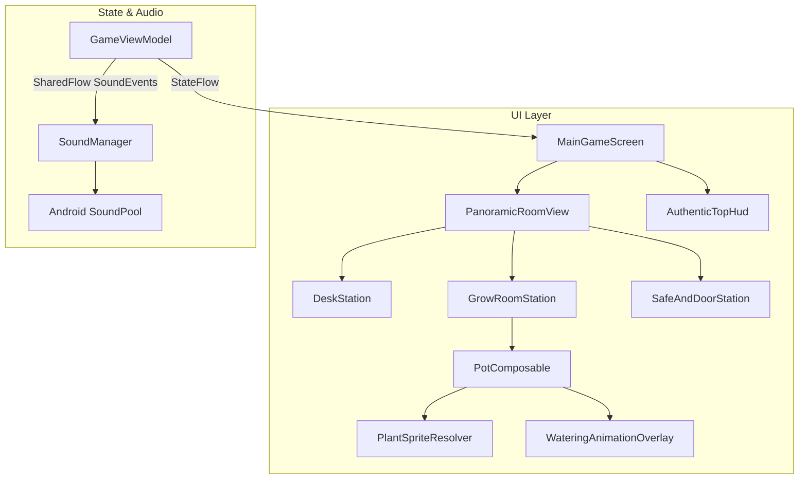

# Specification: Weed Firm 1:1 UI & Audio Rebuild (Phase 1)

**Date:** 2026-10-27  
**Status:** Approved  
**Scope:** Phase 1 - Asset Extraction, Audio Engine, Main Room Panoramic View, Authentic Pots, Plant Sprites, and Top HUD.

---

## 1. Overview & Objective

The objective is to replace the primitive Canvas-based graphics in Green Tycoon with authentic 1:1 visual art, animations, typography, and sound effects extracted from the reverse-engineered `weed-firm.apk` (`com.thumbspire.weedfirmRP`). 

Phase 1 focuses on:
1. Extracting and organizing all real assets (drawables, audio, fonts) from `weed-firm.apk`.
2. Setting up a low-latency audio engine (`SoundManager`) using Android's `SoundPool`.
3. Rebuilding the Main Room Screen with a panoramic horizontal scroll layout (Desk on the left, Grow Area in the center, Safe & Door on the right).
4. Rendering true-to-game pot graphics and plant growth stage sprites (`weed_0_1` to `weed_0_7`).
5. Adding watering animations, interactive pot action overlays, and a Weed Firm styled Top HUD.

---

## 2. Reverse-Engineered Asset Mapping & Extraction

Using binary analysis of `resources.arsc`, the following assets are extracted and placed into the project:

### 2.1 Drawables (`app/src/main/res/drawable/`)
* **Room Backgrounds:**
  * `room_0_a.jpg`, `room_0_b.jpg` (Main apartment background, brick wall, window, floor)
* **Pots:**
  * `pot_0.png` (Plastic pot)
  * `pot_1.png` (Clay / ceramic pot)
  * `pot_2.png` (Hydroponic pot)
* **Plant Growth Sprites:**
  * `weed_0_1.png` (Seedling in soil, 0-14%)
  * `weed_0_2.png` / `weed_0_3.png` (Early sprout, 15-39%)
  * `weed_0_4.png` / `weed_0_5.png` (Vegetative bushy plant, 40-74%)
  * `weed_0_6.png` (Budding / flowering plant, 75-99%)
  * `weed_0_7.png` (Mature harvest-ready buds, 100%)
  * Corresponding sprites for secondary strains (`weed_1_X`, `weed_2_X`, `weed_3_X`, `weed_4_X`).
* **Interactive Room Elements:**
  * `btn_door.png` (Entrance door)
  * `desk_weed.png` (Stash jars on desk)
  * `desk_cash.png` (Cash bundles on desk)
  * `safe_close.png`, `safe_open.png` (Wall safe)
  * `watering_0_anim_0.png`, `watering_0_anim_1.png`, `watering_0_anim_2.png` (Watering animation frames)
  * `btn_shop.png`, `btn_cash.png` (UI buttons and icons)

### 2.2 Audio SFX (`app/src/main/res/raw/`)
* `water.ogg` / `watering.ogg` (Water pouring sound)
* `cut.ogg` (Harvesting snip sound)
* `ds.ogg` / `fertilize.ogg` (Fertilizer spray sound)
* `earn.ogg` (Cash register chime)
* `bell.ogg` (Door bell chime for visitors)
* `door_open.ogg`, `door_close.ogg` (Door creak sounds)
* `burglary.ogg`, `fail.ogg` (Event sounds)

### 2.3 Fonts (`app/src/main/assets/fonts/`)
* `chalkduster.ttf`
* `tweed.ttf`
* `tweed_bold.ttf`

---

## 3. Architecture & Components

### 3.1 `SoundManager`
* Implemented as a singleton or injected helper using Android `SoundPool.Builder`.
* Pre-loads all critical sound IDs on application start.
* Listens to `GameSoundEvent` emitted by `GameViewModel`:
  * `GameSoundEvent.Water`
  * `GameSoundEvent.Fertilize`
  * `GameSoundEvent.Harvest`
  * `GameSoundEvent.CashEarned`
  * `GameSoundEvent.CustomerArrived`
  * `GameSoundEvent.DoorOpen` / `DoorClose`

### 3.2 `PlantSpriteResolver`
* Maps `(strainId: String, progress: Float, stage: GrowthStage)` to the exact drawable resource ID.
* Provides guaranteed fallbacks to prevent crashes or missing asset glitches.

### 3.3 `PanoramicRoomView` Composable
* Horizontal scrollable container (`rememberScrollState()`).
* **Station 1 (Left - Desk):**
  * Wooden desk with `desk_weed` and `desk_cash`.
  * Tap action opens stash/inventory overview.
* **Station 2 (Center - Grow Area):**
  * Displays row of pots matching the player's unlocked pot slots.
  * Renders pot base graphic, plant sprite overlay at optical alignment, moisture progress bar, and growth stage text.
  * Tapping pot opens the Pot Action Sheet (Water, Fertilize, Harvest, Upgrade Pot).
  * Plays watering animation overlay upon watering.
* **Station 3 (Right - Door & Safe):**
  * Displays the front door with animated knocking/bell badge when a customer is waiting.
  * Displays wall safe for storage.

### 3.4 `AuthenticTopHud` Composable
* Top bar with dark textured surface and Tweed font typography.
* Formatted Cash display (`$X,XXX.XX`) with cash bundle icon.
* Respect stars and Level badge with XP bar.
* Quick-action buttons (Shop, Door Bell notification).

---

## 4. Error Handling & Edge Cases

1. **Audio Device Incompatibility / Silent Mode:** `SoundPool` calls will be wrapped in try/catch and checked against sound loading status (`onLoadCompleteListener`). Silent/vibrate phone states will be handled gracefully without game crashes.
2. **Missing Asset Fallback:** If an unrecognized strain ID is passed to `PlantSpriteResolver`, it defaults to the primary strain (`weed_0_X`).
3. **Screen Orientation & DPI Scaling:** All drawables are scaled proportionally using Compose `ContentScale.Fit` or fixed DP dimensions maintaining original aspect ratios so the room renders crisp on all device sizes.
4. **Animation Coroutine Cancellation:** The watering animation uses a bounded coroutine cycle that cancels cleanly if the player navigates away.

---

## 5. Verification & Testing Plan

1. **Unit Tests:**
   * Test `PlantSpriteResolverTest` ensuring all 5 growth stages map to valid non-zero drawable resources for each strain.
   * Test `GameViewModelSoundEventTest` asserting that invoking `WaterPot`, `FertilizePot`, `HarvestPot`, and `AcceptDeal` properly emits the respective sound events.
2. **Build Verification:**
   * Run Gradle compilation (`assembleDebug`) to ensure all drawables, fonts, and raw audio files build without syntax or resource collision errors.
3. **Automated CI Workflow:**
   * Ensure `.github/workflows/unit-tests.yml` runs all unit tests and reports success.
